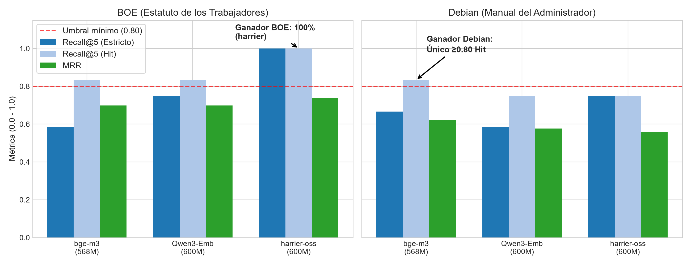
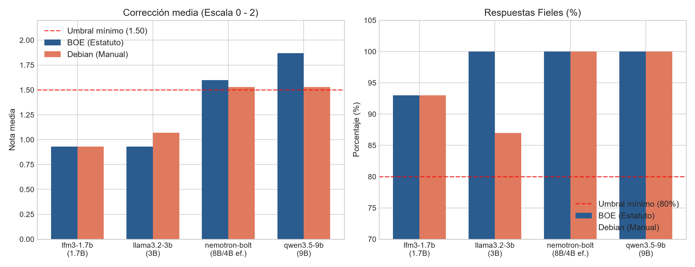
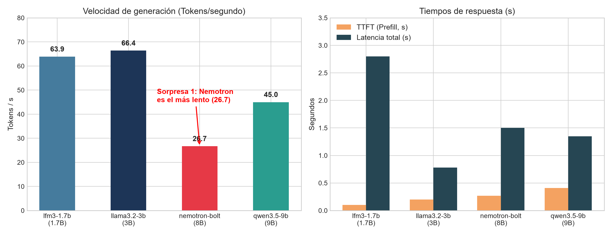
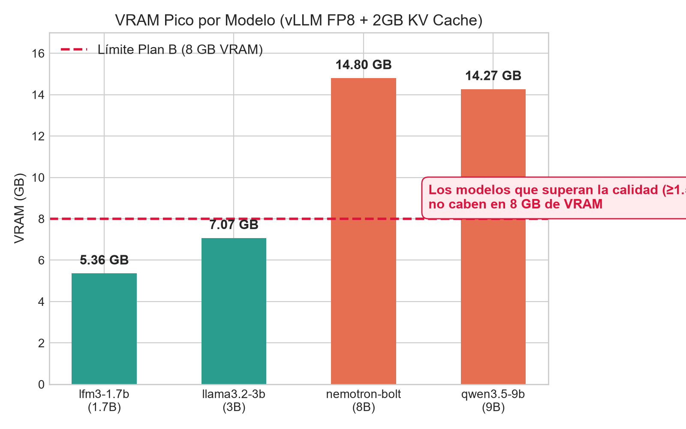

# Benchmark RAG: Embeddings y LLMs Locales
## Grupo 1 · Evaluación Experimental sobre BOE y Debian

---

## 1. Contexto y Objetivos

- **Objetivo:** Determinar empíricamente la combinación óptima de modelo de embedding y LLM local para un pipeline RAG en dos escenarios contrastados.
- **Escenario 1 (Normativa larga):** *Estatuto de los Trabajadores (BOE)* — Lenguaje jurídico, artículos similares, citas exactas.
- **Escenario 2 (Técnico):** *Manual del Administrador de Debian* — Mezcla de prosa técnica, rutas, comandos y términos en inglés.
- **Hardware y Stack:**
  - Instancia MIG 3g.20gb (20 GB VRAM) en NVIDIA A800 40GB.
  - vLLM 0.34.0 (PyTorch 2.14.0+cu130) en FP8 (solo-pesos en Ampere).

---

## 2. Fase 1: Corpus y Golden Set

- **Procesamiento de documentos:**
  - BOE: Limpieza estricta de cabeceras/pies de página con Docling/regex (`scripts/convertir_boe.py`).
  - Debian: Conversión desde EPUB preservando títulos de sección y rutas (`scripts/convertir_debian.py`).
  - Chunking semántico troceado a máx. 1.800 caracteres por fragmento (`scripts/trocear.py`).
- **Golden Set (15 preguntas por escenario):**
  - **8 directas:** Respuesta en 1 solo fragmento.
  - **4 combinadas:** Requieren relacionar 2 fragmentos distintos.
  - **3 sin respuesta:** Preguntas ausentes del corpus para medir abstención real.

---

## 3. Fase 2: Benchmark de Embeddings (Tabla A)

| Escenario | Modelo | Recall@5 (Hit) | Recall@5 (Estricto) | MRR | Indexado | VRAM |
|---|---|---|---|---|---|---|
| **BOE** | `bge-m3` | 0.8333 | 0.5833 | 0.6983 | 1.06 s | 1.89 GB |
| **BOE** | `Qwen3-Embedding-0.6B` | 0.8333 | 0.7500 | 0.6991 | 1.59 s | 3.51 GB |
| **BOE** | **`harrier-oss-v1-0.6b` (Ganador)** | **1.0000** | **1.0000** | **0.7361** | 1.60 s | 3.51 GB |
| **Debian** | **`bge-m3` (Ganador)** | **0.8333** | 0.6667 | **0.6219** | 3.52 s | 1.90 GB |
| **Debian** | `Qwen3-Embedding-0.6B` | 0.7500 | 0.5833 | 0.5769 | 5.29 s | 3.49 GB |
| **Debian** | `harrier-oss-v1-0.6b` | 0.7500 | 0.7500 | 0.5573 | 5.34 s | 3.51 GB |

> **Decisión de Retrieval:** El mejor modelo cambia según el dominio. En el BOE, *harrier* es impecable (100% recuperación). En Debian (técnico multilingüe), el encoder tradicional *bge-m3* es el único que supera el umbral del 80%.

---

## 4. Fase 3: Benchmark de LLMs - Calidad (Tabla B)

| Escenario | Modelo | Tamaño | Corrección (0-2) | Fidelidad | Abstención (de 3) | Falsas Abst. | Formato |
|---|---|---|---|---|---|---|---|
| **BOE** | `lfm3-1.7b` | 1.7B | 0.93 | 93 % | 3 de 3 | 11 de 12 | 40 % |
| **BOE** | `llama3.2-3b` | 3B | 0.93 | 100 % | 3 de 3 | 6 de 12 | 93 % |
| **BOE** | `nemotron-bolt` | 8B/4B ef. | 1.60 | 100 % | 3 de 3 | 1 de 12 | 100 % |
| **BOE** | **`qwen3.5-9b` (Ganador)** | 9B | **1.87** | **100 %** | **3 de 3** | **1 de 12** | **93 %** |
| **Debian** | `lfm3-1.7b` | 1.7B | 0.93 | 93 % | 3 de 3 | 12 de 12 | 40 % |
| **Debian** | `llama3.2-3b` | 3B | 1.07 | 87 % | 3 de 3 | 5 de 12 | 73 % |
| **Debian** | **`nemotron-bolt` (Ganador)** | 8B/4B ef. | **1.53** | **100 %** | **3 de 3** | **3 de 12** | **100 %** |
| **Debian** | `qwen3.5-9b` | 9B | 1.53 | 100 % | 3 de 3 | 3 de 12 | 67 % |

---

## 5. Fase 3: Benchmark de LLMs - Coste y Rendimiento (Tabla C)

| Modelo | TTFT (s) | Tokens/s (BOE) | Latencia Total | VRAM Pico (Instancia) |
|---|---|---|---|---|
| `lfm3-1.7b` | 0.10 s | 63.9 tok/s | 2.80 s | 5.36 GB |
| `llama3.2-3b` | 0.20 s | **66.4 tok/s** | **0.78 s** | 7.07 GB |
| `nemotron-bolt-e4b` | 0.27 s | 26.7 tok/s | 1.50 s | 14.80 GB |
| `qwen3.5-9b` | 0.41 s | 45.0 tok/s | 1.35 s | 14.27 GB |

---

## 6. Recomendaciones Finales por Escenario

### Escenario 1: BOE (Estatuto de los Trabajadores)
- **Selección:** `microsoft/harrier-oss-v1-0.6b` + `Qwen/Qwen3.5-9B` (FP8)
- **Motivo:** Máxima corrección del benchmark (1.87 / 2.0), 100% fidelidad, excelente velocidad (45 tok/s). Recuperación perfecta del contexto jurídico (Recall@5 = 1.0).

### Escenario 2: Manual de Debian
- **Selección:** `BAAI/bge-m3` + `nvidia/NVIDIA-Nemotron-3.5-Bolt-E4B-BF16` (FP8)
- **Motivo:** *bge-m3* es el único que recupera ≥80% en jerga técnica. Nemotron empata en corrección (1.53) y fidelidad (100%), pero cumple el formato al 100% (citas de sección impecables) frente al 67% de Qwen.

---

## 7. Plan B: Restricción a 8 GB de VRAM

> **Conclusión directa:** Ninguno de los modelos evaluados que supera los umbrales de calidad cabe en 8 GB de VRAM.

- `qwen3.5-9b` (14.3 GB) y `nemotron` (14.8 GB) rebasan el límite.
- `lfm3-1.7b` y `llama3.2-3b` sí caben (5.4 y 7.1 GB), pero sufren una tasa inaceptable de falsas abstenciones (se niegan a responder el 50% - 92% de las preguntas con respuesta).
- **Acción recomendada en Plan B:** Cuantización extrema (AWQ 4-bits o GGUF Q4_K_M) de modelos medianos, o ajuste fino (fine-tuning) en un modelo de 3B para corregir la histeria de abstención.

---

## 8. Lo que no esperábamos (Anomalías y Sorpresas)

1. **Nemotron (4B efectivos) es el más lento, no el más rápido:**
   - Dio solo **26.7 tok/s** (frente a 45 de Qwen-9B y 66 de Llama-3B).
   - *Causa:* vLLM carga los 8B completos en VRAM (14.8 GB) y recurre a kernels menos optimizados (`TRITON_ATTN` + FP8 Marlin).
2. **El embedding ganador varía radicalmente por dominio:**
   - *Harrier* es el mejor en BOE (100%) pero cae al peor en Debian (75%).
   - *bge-m3* (encoder tradicional) salvó el escenario técnico con términos en inglés.
3. **LFM3-1.7B dice "No aparece en el documento"... y luego responde bien:**
   - Falsa abstención por reflejo en 11/12 preguntas; sin embargo, en 8 de ellas añade inmediatamente después la respuesta correcta ("Sin embargo, según el fragmento 1...").
   - Con oráculo su calidad salta de 0.67 a 1.25. El modelo pequeño colapsa por ruido cuando recibe 5 chunks.

---

## 9. Trazabilidad y Reproducibilidad

Todo el flujo es reproducible de principio a fin desde la raíz del repositorio:
- `uv run python scripts/run_all_embeddings.py` (Fase 2)
- `uv run python scripts/benchmark_llms_vllm.py` (Fase 3)
- `uv run python scripts/generar_tablas_llm.py` (Generación de Tablas B y C)
- `python scripts/generar_graficos.py` (Visualizaciones)

**Grupo 1:** Nicolás Pascual · Aimar Mora · Íñigo Guzmán
